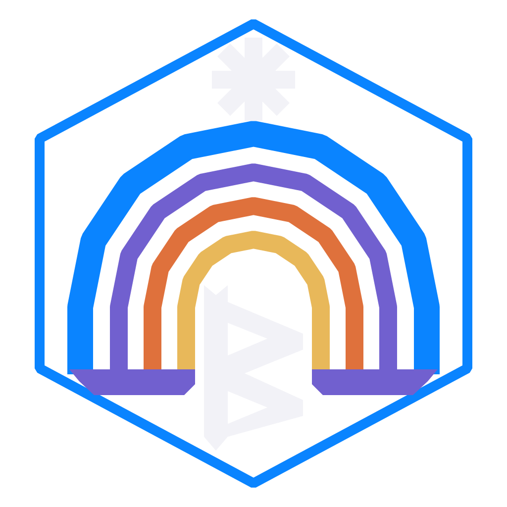

<div align="center">



# BifrOSt for PC

A desktop operating system for PCs, written in Rust, with a macOS-style desktop, its own window server, shell, SDK and apps.

[Website](https://bifrost.olibuijr.com) | [Install](https://bifrost.olibuijr.com/install/) | [Developer docs](https://bifrost.olibuijr.com/docs/) | [App Store](https://bifrost.olibuijr.com/store/) | [Account](https://bifrost.olibuijr.com/account/)


</div>

BifrOSt is a personal project in active development. It boots from its own UEFI loader, installs onto an Arch Linux base with a native installer, and starts a desktop with a menu bar, a dock, traffic-light windows, floating panels, sheets and system search. The window server, shell, renderer, SDK, UI kit, update service and about fifty apps are Rust code in one workspace.

- [Status](#status)
- [Architecture](#architecture)
- [Hardware](#hardware)
- [Build and run](#build-and-run)
- [Fonts and assets](#fonts-and-assets)
- [Repository layout](#repository-layout)
- [Documentation](#documentation)

## Status

BifrOSt is not a finished system. There is no public install image yet; the live USB image is built only for the author's lab. Releases are cut as often as every finished change, and the shell is at version 0.7.x.

Coverage against the reference desktop SDKs is tracked in a matrix (`docs/parity-matrix/`). On 2026-10-13, `python3 tools/bifrost.py pc parity status` reported:

| Measure | Result |
|---|---|
| Frameworks assessed | 246 of 246 |
| Frameworks created | 185: 165 partial, 20 OS only, 0 complete |
| SDK feature rows covered | 71.0% of 1,965 applicable rows |
| Rows built (partial or parity) | 86.5% |

`python3 tools/bifrost.py pc parity os-status` reports the same for the reference OS layer (apps, daemons, command-line tools, settings, assets): 44.7% of 5,722 applicable components. No framework is marked complete yet. A row only counts as `parity` once it works on the lab machine, so these numbers will move slowly.

Open problems are listed in [`docs/window-server.md`](docs/window-server.md) and the other design docs.

> [!NOTE]
> The names of Apple platforms and products are not used in the code, and a name guard enforces that (`python3 tools/bifrost.py pc names`). BifrOSt is not affiliated with or endorsed by Apple.

## Architecture

| Part | What it does | Where |
|---|---|---|
| Window server (`bifrost-wm`) | A Wayland compositor on Smithay. It owns window placement, focus and input, and composites every frame, including live blur behind translucent surfaces. Runs on DRM/KMS with libinput and libseat. | [`springboard/wm`](springboard/wm), [`docs/window-server.md`](docs/window-server.md) |
| Shell | Menu bar, dock, Settings, Spotlight, lock screen and window chrome. A separate client of the window server. | [`springboard/src`](springboard/src) |
| Render | The 2D renderer, GPU presenter and materials (glass, shadows, motion). GPU-first. | [`springboard/render`](springboard/render), [`springboard/gpu`](springboard/gpu), [`docs/gpu-first.md`](docs/gpu-first.md) |
| SDK and UI kit | `bifrost-app` for apps and `bifrost-ui` for controls, text editing and testing support. The shell uses the same controls. | [`springboard/sdk`](springboard/sdk), [`springboard/ui`](springboard/ui), [`docs/bifrost-ui.md`](docs/bifrost-ui.md) |
| System services | Background daemons: the update agent, audio, networking, privileged operations, and an MCP server for driving the machine. | [`springboard/updated`](springboard/updated), [`springboard/audio`](springboard/audio), [`springboard/netd`](springboard/netd), [`springboard/mcp`](springboard/mcp) |
| Apps | One crate per app, packaged as installable store apps. | [`springboard/apps`](springboard/apps) |
| Installer | A native installer that draws on DRM/KMS and runs from the live image. New installs use Btrfs with separate system, home, app-state, recovery, cache and log subvolumes. | [`docs/installer.md`](docs/installer.md) |
| Updates and rollback | Settings > Software Update installs OS updates; the App Store installs and updates apps. On Btrfs, an update snapshots the root and the matching kernel first, and a new version that fails to boot is rolled back on its own. | [`docs/system-recovery.md`](docs/system-recovery.md) |

The shell is a separate process from the window server on purpose: a privileged shell should not also be the server for untrusted apps. If `bifrost-wm` exits three times in quick succession, the session falls back to a safe mode and then to the recovery flow.

Site pages on the same topics: [architecture](https://bifrost.olibuijr.com/docs/architecture/), [boot and update](https://bifrost.olibuijr.com/docs/boot-and-update/), [system services](https://bifrost.olibuijr.com/docs/system-services/).

## Hardware

- **Tested:** a Lenovo ThinkCentre M900 Tiny with Intel graphics, called Midget in the docs. It is the only physical test machine. Virtual machines are used for installer runs.
- **Untested:** AMD and NVIDIA. They should work through the same drivers, but nobody has tried. Without a usable GPU driver the desktop still runs, more slowly.
- **Needs:** a 64-bit PC with UEFI, and a network connection during installation, because the installer pulls the base system from package mirrors.

Install and recovery steps are on the [install page](https://bifrost.olibuijr.com/install/).

## Build and run

You need Linux, a stable Rust toolchain (`rustup`), and Wayland with `wlr` protocols or DRM/KMS to run the shell. Pack the assets first (see [Fonts and assets](#fonts-and-assets)), since some tests and previews load the UI fonts.

```sh
git clone https://github.com/olibuijr/bifrost-os.git
cd bifrost-os/springboard

# Optimised incremental build of the shell
cargo build --profile fast --bin shell --features desktop-wayland

# Tests
cargo test
```

Full link-time optimisation is opt-in; the `fast` profile is the default for iteration.

From the repository root, the `bifrost` CLI wraps the common tasks:

```sh
python3 tools/bifrost.py pc acceptance --quick     # tests, SDK coverage and app checks
python3 tools/bifrost.py pc smoke files --light    # host preview of one app
python3 tools/bifrost.py pc gallery                # previews of all apps
python3 tools/bifrost.py pc names                  # name guard
python3 tools/bifrost.py pc parity status          # coverage against the reference SDKs
```

To try a change on a PC, `tools/midget-push-shell.sh --no-build shot.png` pushes a built shell to the lab machine and takes a screenshot. A release is a version bump in `springboard/Cargo.toml` and `CHANGELOG.md`, then `bifrost pc publish` and `bifrost pc midget update --restart`. ISOs are only for changes to the boot path; everything else ships through System Update and the App Store. The full workflow, including unattended VM reinstall cycles, is in [`docs/bifrost-pc-workflow.md`](docs/bifrost-pc-workflow.md).

> [!WARNING]
> The installer erases disks, and `bifrost pc midget` and `bifrost pc cycle` drive it on the lab machine. Only run them against a machine you are happy to wipe.

## Fonts and assets

BifrOSt ships only open-source fonts (SIL Open Font Licence 1.1). The defaults are the closest open lookalikes
of the macOS system fonts, and Settings > General > Fonts can replace the system and monospaced fonts with
others from BifrOSt's font library.

**Defaults** (packed under the asset names the code loads):

| Asset file | Font | Stands in for | Why |
|---|---|---|---|
| `SFUI.ttf` | [Inter](https://rsms.me/inter/) | SF Pro | Variable, with both a weight (`wght`) and an optical size (`opsz`) axis, like SF Pro; the closest open match |
| `SFUIMono.ttf` | [JetBrains Mono](https://www.jetbrains.com/lp/mono/) | SF Mono | Variable (`wght` 100 to 800), with a neutral, screen-first design like SF Mono |
| `Symbols.ttf` | [Noto Sans Symbols 2](https://fonts.google.com/noto/specimen/Noto+Sans+Symbols+2) | Apple Symbols | Maps symbols by Unicode, as the shell looks them up; resolves 18 of the shell's 22 symbols |

No open-source font of SF Symbols exists. The shell falls back to `Symbols.ttf` and its hand-drawn glyphs
(Wi-Fi, battery and gear are hand-drawn).

**Font library** (`fonts/`, offered in Settings > Fonts): Geist, IBM Plex Sans and Source Sans 3 for the system
font; Geist Mono, Fira Code and Source Code Pro for the monospaced font. All are variable fonts, so every weight
the desktop uses renders. Fonts that apps install go in the same folder (`/var/lib/springboard/fonts`). Settings
lists only this library, never the host's or the distribution packages' fonts. A choice is saved in
`settings.ini` (`font_system`, `font_mono`), takes effect when BifrOSt restarts, and applies to every app;
a font that fails to load falls back to the default.

`springboard/tools/pack.py` fetches all of these from one pinned [google/fonts](https://github.com/google/fonts)
commit, checks each file's SHA-256 and caches them in `~/.cache/bifrost/fonts`. The arguments are documented at the top of the script.

Notes:

- The pixel snapshot goldens in `springboard/sdk/tests/snapshots/` are recorded with the default fonts.
- The renderer test `cff_font_renders_through_the_same_path` needs a CFF symbol font
  (`assets/SFUISymbols-Regular.otf`) and is skipped without one; no default font uses CFF outlines.

## Repository layout

| Path | Contents |
|---|---|
| [`springboard/`](springboard) | The Rust workspace: shell, window server, installer, SDK, UI kit, renderer, services and apps |
| [`springboard/apps/`](springboard/apps) | Desktop apps, one crate per app |
| [`springboard/wallpapers/`](springboard/wallpapers) | Royalty-free wallpapers, packed for the shell by `tools/pack.py` |
| [`packaging/`](packaging) | Arch Linux packaging, the archiso profile for the installer ISO, brand marks and lab units |
| [`tools/`](tools) | The `bifrost` CLI, app packaging, Midget lab helpers, checks and benchmarks |
| [`docs/`](docs) | Design notes, SDK guides, UI kit reference, parity matrix and workflow docs |
| [`android/midget-remote/`](android/midget-remote) | Companion Android app for controlling a BifrOSt machine |
| [`task/`](task) | Planned work items |

## Documentation

On the website: the [developer docs](https://bifrost.olibuijr.com/docs/) start with the [quick start](https://bifrost.olibuijr.com/docs/quick-start/), and cover the [UI kit](https://bifrost.olibuijr.com/docs/ui-kit/), [testing](https://bifrost.olibuijr.com/docs/testing/), [app lifecycle](https://bifrost.olibuijr.com/docs/app-lifecycle/), [publishing](https://bifrost.olibuijr.com/docs/publishing/) and [platform parity](https://bifrost.olibuijr.com/docs/platform-parity/).

In this repository:

| Topic | Read |
|---|---|
| Working conventions, design rules, review checklist | [`AGENTS.md`](AGENTS.md) |
| Building, publishing, the lab machine | [`docs/bifrost-pc-workflow.md`](docs/bifrost-pc-workflow.md), [`docs/build-performance.md`](docs/build-performance.md) |
| Window server | [`docs/window-server.md`](docs/window-server.md), [`docs/wayland-desktop.md`](docs/wayland-desktop.md) |
| Rendering and materials | [`docs/gpu-first.md`](docs/gpu-first.md) |
| SDK and UI kit | [`docs/bifrost-ui.md`](docs/bifrost-ui.md), [`docs/golden-gate-sdk-adoption.md`](docs/golden-gate-sdk-adoption.md) |
| Design decisions | [`docs/design-golden-gate.md`](docs/design-golden-gate.md) |
| Parity matrix | [`docs/apple-parity-matrix.md`](docs/apple-parity-matrix.md) |
| Installer, boot and recovery | [`docs/installer.md`](docs/installer.md), [`docs/installer-and-boot.md`](docs/installer-and-boot.md), [`docs/system-recovery.md`](docs/system-recovery.md) |
| Agent access to the lab machine | [`docs/bifrost-mcp.md`](docs/bifrost-mcp.md) |

Licence and credits: [`LICENSE`](LICENSE), [`CREDITS.md`](CREDITS.md).
